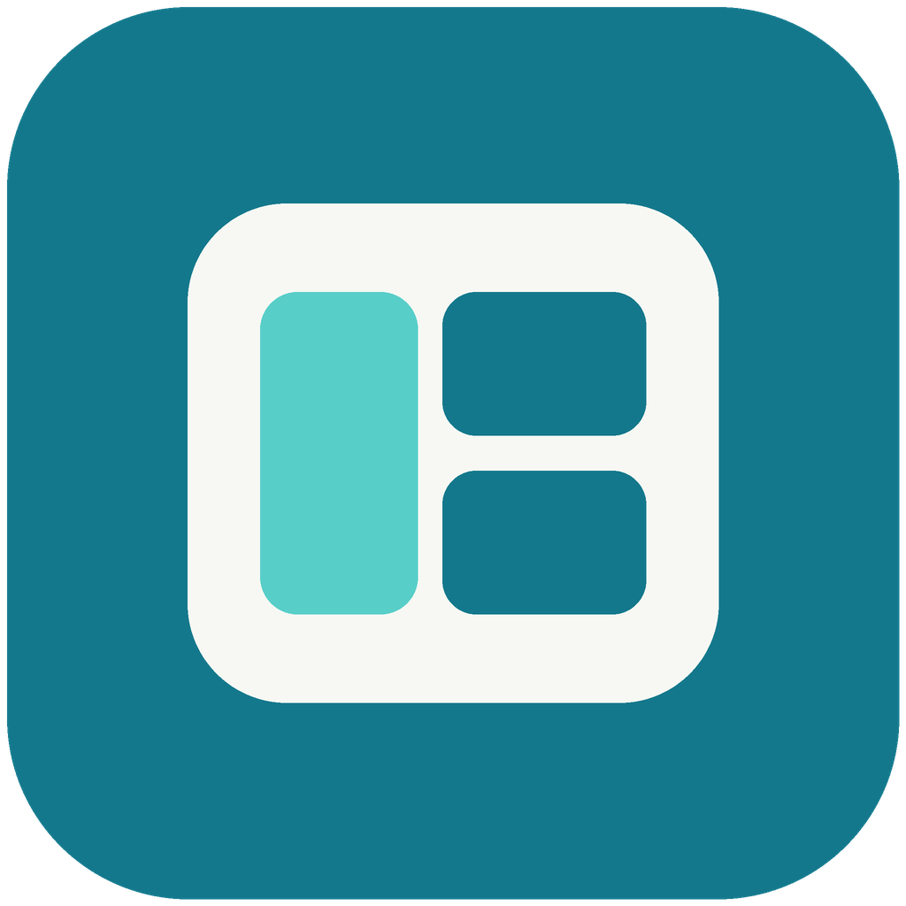

<p align="center">
  
</p>

<h1 align="center">CloudDock</h1>

<p align="center">在一个 macOS 窗口里管理阿里云控制台。</p>

<p align="center">
  macOS · Apple Silicon / Intel · <a href="LICENSE">MIT License</a>
</p>

CloudDock 把常用控制台、地域入口、收藏和工作标签放在一起。适合经常在集群、数据库、代码仓库和日志页面之间切换的开发者与运维人员。

你仍然使用阿里云原生页面和登录流程。CloudDock 不是阿里云官方客户端，不需要配置 AccessKey，也不调用产品 OpenAPI。

[快速开始](#快速开始) · [使用方法](#使用方法) · [快捷键](#快捷键) · [Chrome 扩展](#chrome-扩展) · [开发与验证](#开发与验证)

## 支持的控制台

| 模块 | 侧栏入口 |
| --- | --- |
| ACK | 按已选地域打开集群控制台 |
| Kafka | 按已选地域打开消息队列控制台 |
| MSE | 按已选地域打开控制台，目前支持北京、上海 |
| DMS | 数据管理全局入口 |
| Codeup | 代码管理全局入口，也支持 Flow 流水线页面 |
| SLS | 日志服务全局入口 |

各模块可单独启用、关闭和配置地域。侧栏还提供阿里云控制台首页；ECS、RDS、OSS、CloudMonitor 等已支持的地址可作为临时标签打开。

## 可以做什么

- **保留工作现场**：多标签切换、固定和拖动排序，重启后恢复标签、收藏与筛选条件。
- **直接回到常用页面**：收藏具体资源；为 Codeup 仓库、Flow 流水线和 SLS 查询保存命名快捷入口。同模块内继续浏览时保留入口高亮。
- **快速找到下一项工作**：搜索标签、收藏、最近访问和最近关闭页面，按产品或待处理、处理中、已完成状态筛选标签。
- **从消息中打开链接**：粘贴一段包含控制台链接的文字，预览、去重后打开，单次最多 10 个。
- **在应用内完成浏览**：后退、前进、刷新、页内查找、下载，以及从 Chrome 跳转到桌面应用。
- **控制后台占用**：标签按需加载，后台视图按内存情况回收；关闭和回收时保留页面的未保存内容保护。

## 快速开始

从 [GitHub Releases](https://github.com/EthanWFL/clouddock/releases) 下载安装包，无需安装 Node.js。当前可下载版本为 **2.1.0**，按“关于本机”中的芯片或处理器选择：

| Mac 类型 | 下载 |
| --- | --- |
| Apple Silicon（M 系列芯片） | [CloudDock-2.1.0-arm64.dmg](https://github.com/EthanWFL/clouddock/releases/download/2.1.0/CloudDock-2.1.0-arm64.dmg) |
| Intel 处理器 | [CloudDock-2.1.0-x64.dmg](https://github.com/EthanWFL/clouddock/releases/download/2.1.0/CloudDock-2.1.0-x64.dmg) |

下载后打开 DMG，将 CloudDock 拖入 Applications。详细安装步骤和 macOS 安全提示见下方“构建并安装 DMG”。暂不提供 Windows 和 Linux 安装包；Intel 包已通过构建与架构校验，Intel 真机上的登录、安装与日常操作仍需验收。

安装包作为 Release 附件单独存储，不进入 Git 历史。可下载 [SHA256SUMS.txt](https://github.com/EthanWFL/clouddock/releases/download/2.1.0/SHA256SUMS.txt)，在下载目录执行 `shasum -a 256 -c SHA256SUMS.txt`。只下载一种架构时，另一项会提示缺失，已下载文件应显示 `OK`。

系统要求为 **macOS 12 Monterey 或更新版本**；支持 Intel 不代表支持 macOS 11 或更早系统。

### 从源码运行

需要 Node.js 和 npm。推荐使用 [.nvmrc](.nvmrc) 指定的 Node.js 24.18.0 与 npm 11，最低 Node.js 版本为 22.12.0。主分支可能包含晚于安装包的文档或代码更新；复现 2.1.0 安装包时，在克隆后先执行 `git checkout 2.1.0`。

```bash
git clone https://github.com/EthanWFL/clouddock.git
cd clouddock
npm ci
npm run dev
```

使用 nvm 时，可以在 `npm ci` 前执行 `nvm install && nvm use`。

### 构建并安装 DMG

```bash
npm run package:mac
```

默认一次生成两种架构的安装包，按“关于本机”中的芯片或处理器选择：

| Mac 类型 | 安装包 |
| --- | --- |
| Apple Silicon（M 系列芯片） | `dist/CloudDock-<版本>-arm64.dmg` |
| Intel 处理器 | `dist/CloudDock-<版本>-x64.dmg` |

也可以单独构建：

```bash
npm run package:mac:arm64
npm run package:mac:x64
```

两种包分别包含对应架构的程序，不是 Universal 合并包。安装方法相同：

1. 打开 DMG，将 CloudDock 拖入 Applications。
2. 首次启动若被 macOS 拦截，可在 Finder 中按住 Control 点击应用并选择“打开”，或在“系统设置 → 隐私与安全性”中选择“仍要打开”。
3. 更新安装前，使用 `Command+Q` 完全退出旧版，再覆盖安装。

当前构建使用 ad-hoc 完整性签名，尚无 Developer ID 签名或 Apple 公证。不要关闭 Gatekeeper 或移除隔离属性来绕过系统检查。重新打包前，也请退出从 `dist/mac-arm64/CloudDock.app` 或 `dist/mac/CloudDock.app` 启动的应用。

<details>
<summary>Electron 下载较慢时</summary>

可在安装依赖时指定镜像：

```bash
ELECTRON_MIRROR=https://npmmirror.com/mirrors/electron/ npm ci
```

若依赖已安装但 Electron 二进制缺失，可单独重试：

```bash
ELECTRON_MIRROR=https://npmmirror.com/mirrors/electron/ node node_modules/electron/install.js
```

打包时 electron-builder 按目标架构下载并缓存 Electron，首次构建两种架构需要分别下载。可通过同一个镜像变量运行打包：

```bash
ELECTRON_MIRROR=https://npmmirror.com/mirrors/electron/ npm run package:mac
```

</details>

## 使用方法

1. **选择模块与地域**：首次启动选择需要的控制台；之后可从侧栏底部“管理模块”调整。
2. **完成登录**：点击入口，在原生页面中完成阿里云登录。MFA、验证码和企业 SSO 按账号要求操作。
3. **保存常用入口**：用工具栏收藏当前页面；Codeup 和 SLS 还可“保存模块快捷入口”，以自定义名称显示在所属模块下。
4. **切换工作**：按 `Command+K` 搜索现有页面，或按 `Command+T` 粘贴链接打开新页面。

`Command+K` 每次打开都是空输入框，不读取剪贴板；`Command+T` 和工具栏“打开链接”会读取剪贴板中的控制台链接供你预览。快速切换器也支持输入 `固定: 集群`、`关闭: 日志` 等命令，再选择要操作的标签。

关闭模块只隐藏入口，已有标签和收藏仍然保留。收藏和快捷入口可通过行末菜单重命名、排序或删除；删除后有 7 秒撤销时间。

### 快捷键

即使焦点在控制台页面内，以下快捷键也可使用。`⌘` 表示 Command，`⇧` 表示 Shift。

| 快捷键 | 操作 |
| --- | --- |
| `⌘ K` | 搜索标签、收藏、历史记录和操作 |
| `⌘ T` | 粘贴并打开控制台链接 |
| `⌘ F` | 页内查找；Enter / ⇧ Enter 切换匹配，Esc 关闭 |
| `⌘ D` | 收藏或取消收藏当前页 |
| `⌘ R` | 刷新当前页 |
| `⌘ [` / `⌘ ]` | 后退 / 前进 |
| `⌘ W` | 关闭当前标签 |
| `⌘ ⇧ T` | 恢复最近关闭的标签 |
| `⌘ 1` … `⌘ 8` / `⌘ 9` | 切换到对应位置 / 最后一个标签 |
| `Control Tab` / `Control ⇧ Tab` | 下一个 / 上一个标签 |

启用产品或任务状态筛选时，切换快捷键使用筛选后的可见标签队列。

## Chrome 扩展

[CloudDock Bridge](chrome-extension/) 将当前浏览器页面交给 CloudDock 打开，目前通过本地加载方式使用：

1. 安装并启动一次打包后的 CloudDock，使 macOS 注册跳转协议。
2. 在 Chrome 扩展管理页（`chrome://extensions`）开启“开发者模式”。
3. 点击“加载已解压的扩展程序”，选择本仓库的 `chrome-extension` 文件夹。
4. 打开扩展选项，添加允许的域名和路径前缀，例如域名 `codeup.aliyun.com`、路径 `/`。
5. 在匹配的 HTTPS 页面点击扩展按钮，或通过右键菜单选择“在 CloudDock 中打开此页”。

扩展默认不允许任何站点。规则保存在 `chrome.storage.sync`；扩展仅申请 `activeTab`、`contextMenus` 和 `storage` 权限，不读取 Cookie 或页面正文。扩展规则与应用的链接校验均需通过。

<details>
<summary>从其他工具跳转，以及配置额外站点</summary>

CloudDock 支持 `clouddock://`，并兼容旧的 `opsdock://`。把 HTTPS 地址用 `encodeURIComponent` 编码后，放入唯一的 `url` 参数：

```text
clouddock://open?url=https%3A%2F%2Fcodeup.aliyun.com%2F
```

默认允许 `*.aliyun.com` 子域名，不包含根域 `aliyun.com`。入口拒绝 HTTP、带账号密码、自定义端口及无效地址；地域型控制台还需要可识别的地域。

需要从外部工具打开其他受信任站点时，可在启动应用前配置：

```bash
CLOUDDOCK_URL_ALLOWLIST="docs.example.com,*.tools.example.com" npm run dev
```

通配规则只匹配子域名，`*.tools.example.com` 不包含 `tools.example.com`。该配置控制外部协议入口和标签恢复，不会取消 HTTPS、凭据或端口限制。

</details>

## 本地数据与隐私

应用数据保存在 `~/Library/Application Support/opsdock/`。目录名为兼容旧版本而保留，应用标识 `io.github.wuerlong.clouddock` 也保持固定。

| 数据 | 保存方式 |
| --- | --- |
| 标签、收藏、快捷入口、筛选条件 | 本地工作区 JSON，包含页面 URL |
| 登录 Cookie 和站点存储 | CloudDock 独立的 Chromium Session |
| 可选保存的账号密码 | 使用 Electron `safeStorage` 加密后写入本地文件 |

账号密码自动填充只在允许的登录域名内填写空字段，不自动提交。工具栏“更多操作 → 退出 RAM 登录”会关闭控制台标签并清除会话，保留收藏和模块设置；已保存的账号密码需要在账号密码管理中单独清除。

分享问题前请脱敏：页面 URL、查询参数和截图可能包含内部资源信息。“复制诊断摘要”不包含页面 URL 和 Cookie；“复制工作区上下文”会包含控制台 URL，请检查后再分享。

## 开发与验证

| 命令 | 用途 |
| --- | --- |
| `npm run dev` | 本地开发 |
| `npm run typecheck` | TypeScript 类型检查 |
| `npm test` | 类型检查、单元测试、Renderer 测试和扩展测试 |
| `npm run test:e2e` | 构建测试版并运行 Electron 端到端测试 |
| `npm run build:extension` | 验证 Chrome 扩展文件与权限配置 |
| `npm run package:mac` | 构建 ARM64 和 Intel x64 两个 DMG |
| `npm run package:mac:arm64` | 仅构建 Apple Silicon 安装包 |
| `npm run package:mac:x64` | 仅构建 Intel 安装包 |
| `npm run verify:release` | 完整发布验证，包含测试、依赖审计，以及两种架构的打包与产物校验 |

只运行发布代码检查、不生成安装包：`npm run verify:release -- --skip-package`。

E2E 使用当前 Mac 架构的 Electron 和本地模拟控制台，不会因构建了两种安装包就自动完成两种芯片的运行测试。发布校验会分别检查两种 DMG 的完整性、签名、主程序及 Electron 框架架构、URL schemes 和 Fuses。真实 RAM/MFA、企业 SSO、控制台页面变化及 Intel 真机安装仍需人工验证。目前未提供自动更新。

- [技术设计](docs/technical-design.md)：模块划分、数据模型与安全边界。
- [人工验收清单](docs/manual-acceptance.md)：发布检查项与历史验证记录。
- [协作与版本规则](AGENTS.md)：提交、版本递增和 tag 约定。

## 反馈与贡献

欢迎通过 [Issues](https://github.com/EthanWFL/clouddock/issues) 提交问题或建议。请附应用版本、macOS 版本、复现步骤和脱敏截图。涉及凭据或安全漏洞时，请先私下联系维护者，不要公开认证信息或可利用细节。

提交 PR 前，请运行与改动相关的检查。新增控制台支持时，说明入口 URL、地域规则和预期行为；测试使用虚构资源与本地模拟页面。

## 许可证

项目代码和原创图标采用 [MIT License](LICENSE)。第三方依赖和素材遵循各自的许可证。
