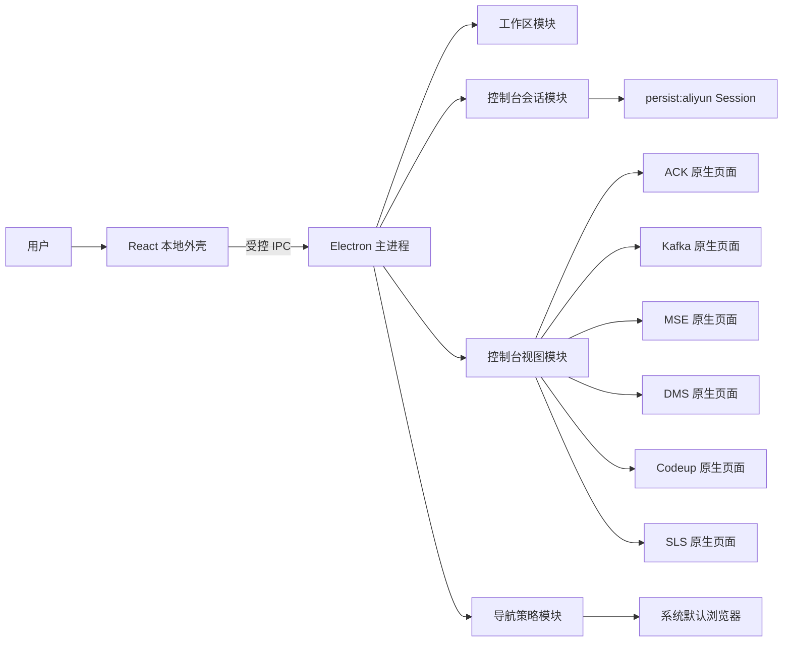

# CloudDock 首版技术方案

状态：已实现，MSE、产品模块配置、DMS、Codeup（含 Flow 流水线）和 SLS 接入完成自动化验证
更新时间：2026-09-07

## 1. 结论

CloudDock 不是阿里云产品的替代控制台，而是一个面向 macOS 的运维浏览器。统一侧栏、标签页、收藏和工作区恢复承载 ACK、Kafka、MSE、DMS、Codeup 与 SLS 原生页面，减少浏览器窗口和控制台入口之间的切换。

应用不接入产品 SDK，也不保存 AccessKey。用户直接在应用内完成 RAM 登录，登录 Cookie 保存在 CloudDock 独立的 Chromium Session 中。应用不读取或重组控制台数据，不通过 DOM 自动执行运维操作。

推荐技术栈是 Electron、React、TypeScript 和 Vite。Electron 的 `WebContentsView`、Session、导航拦截和弹窗接管能力与本项目直接匹配。Tauri 和 SwiftUI 也能加载网页，但要补齐多视图管理、Chromium 兼容性、会话控制和页面弹窗处理，首版没有收益。

## 2. 目标与范围

### 2.1 首版目标

- 在一个窗口内打开 ACK、Kafka、MSE、DMS、Codeup 和 SLS 控制台。
- ACK、Kafka 和 MSE 分别配置多个地域；MSE 仅提供北京、上海入口；DMS/Codeup/SLS 不绑定工作区地域。
- 首次启动选择需要的产品模块，并可从侧栏继续增减；关闭模块不删除标签、收藏和最近关闭记录。
- 保留 RAM 登录状态，应用重启后不重复登录，阿里云会话过期除外。
- 支持收藏具体集群、工作负载、Topic、消费者组、DMS 工作台、Codeup 代码库、Flow 流水线和 SLS 日志查询页面。
- 恢复上次关闭时的标签页，后台标签延迟加载。
- `Command+K` 打开始终为空且不读取剪贴板的快速切换器，用于搜索标签、最近关闭、收藏、模块快捷入口、最近访问和产品入口，也可手动输入受支持的控制台 URL；顶部“打开链接”和 `Command+T` 才进入链接打开模式，从剪贴板消息提取、去重并预览最多 10 个受支持 URL。同名标签用产品上下文和 URL 路径区分，标签按当前、固定、处理中、待处理、未标记、已完成及最近活跃时间排序。输入“操作: 标签关键词”可执行固定、任务状态或关闭操作，不带冒号时保持普通搜索。
- 分别构建 Apple Silicon ARM64 和 Intel x64、无 Developer ID 和公证、带 ad-hoc 完整性签名的 DMG。

### 2.2 不做的内容

- 不重新开发阿里云产品管理页面。
- 不调用产品 OpenAPI 或 Kubernetes API。
- 不支持多个 RAM 账号同时登录。
- 不提供可任意导航的浏览器地址栏；工具栏可粘贴并新开已接入的阿里云控制台链接。
- 不提供应用自有的下载器或下载入口；可信控制台页面仍使用 Electron 原生保存流程。
- 不做跨集群、跨地域的数据聚合。
- 不解析产品控制台 DOM，不录制点击，不自动执行控制台操作；用户主动触发的页内查找使用 Electron 原生 `findInPage` 高亮和滚动定位，只返回匹配数量及序号；登录自动填充只处理精确允许的 RAM 登录域名，且不点击或提交。
- 不把 ECS、RDS、OSS、CloudMonitor 等其他控制台做成固定模块；只允许精确域名的临时直达标签。
- 不做 Intel 包、自动更新、Developer ID 签名和 Apple 公证。

## 3. 已确认的产品规则

| 事项 | 首版规则 |
| --- | --- |
| 页面来源 | ACK、Kafka、MSE、DMS、Codeup、SLS 阿里云原生控制台 |
| 账号 | 一个持久化 RAM 会话 |
| 地域 | ACK/Kafka 可分别选择任一已知地域，MSE 可选择北京或上海，DMS/Codeup/SLS 标签不绑定工作区地域 |
| 模块 | 首次启动至少选择一个；后续可增减；只控制入口可见性，不作为权限边界 |
| 窗口 | 单窗口、多标签 |
| 标签恢复 | 保存当前 URL、产品、地域、标题、固定/任务状态和激活顺序 |
| 页面加载 | 当前标签立即加载，后台标签首次激活时加载 |
| 固定入口 | ACK + 地域、Kafka + 地域、MSE + 北京/上海、DMS、Codeup、SLS 全局入口 |
| 资源直达 | 用户收藏当前详情页 |
| 外部链接 | 任意 HTTPS 页面留在应用内，不按域名限制跳转 |
| 下载 | 已识别控制台页面允许并显示原生保存窗口与进度/结果反馈，外部页面继续阻止 |
| 打开链接 | `Command+K` 以空查询打开；顶部按钮和 `Command+T` 可从消息中提取、去重、预览并批量打开最多 10 个已接入或精确允许的临时控制台 HTTPS 链接 |
| 界面 | 中文、浅色 |
| 安装包 | Apple Silicon ARM64 / Intel x64 独立 DMG，无 Developer ID/公证，带 ad-hoc 完整性签名 |

## 4. 技术栈

### 4.1 桌面运行时

- Electron：主进程、窗口、Session、`WebContentsView` 和系统能力。
- electron-vite：主进程、Preload 和 Renderer 的构建入口。
- electron-builder：生成 ARM64 `.app` 和 `.dmg`。

实现时选择当期稳定版本并锁定依赖，不在方案阶段固定具体版本号。

### 4.2 本地界面

- React + TypeScript：侧栏、标签栏、工具栏、设置和收藏管理。
- Zustand：本地界面状态。持久状态仍由主进程管理。
- `cmdk`：`Command+K` 快速切换器，仅在首次打开时加载独立 chunk。
- `lucide-react`：导航和工具按钮图标。
- 全局 CSS：本地界面只有一个 HTML 和应用入口，由统一样式表维护；命令面板按需拆分，不引入完整设计系统。

`App.tsx` 负责布局与应用级事件；侧栏、标签栏、工具栏、页内查找、模块设置和编辑弹窗按已有组件边界分文件。Zustand 接收快照时复用未变化的列表项与配置引用，主要组件按所需字段订阅，并使用 `memo` 避免父组件更新带来的重复渲染。

标签栏中的单个标签使用 `memo`，后台加载状态变化只重新渲染对应标签。完整列表索引一次计算，任务计数单次遍历；键盘操作从最新状态计算可见队列，避免为每次加载更新重建所有标签内容。

### 4.3 数据与校验

- Zod：校验 IPC 消息、持久化文件和 URL 解析结果，仅进入主进程校验路径，不进入 Renderer bundle。
- 主进程 JSON 存储：保存标签、收藏、地域和窗口尺寸，使用临时文件加原子替换写入。
- Electron Session：只用于控制台 Cookie、缓存和站点存储。

本地 JSON 不保存 Cookie、密码、AccessKey 或页面正文。

## 5. 总体结构



本地 React 外壳和远程控制台页面使用不同的 WebContents：

- Renderer WebContents 只渲染 CloudDock 界面，通过 Preload 暴露少量 IPC 命令。
- 本地 Renderer 通过只读、安全的 `app://renderer` 协议加载；协议处理器只读取 Renderer 构建目录，拒绝其他 origin、非 GET/HEAD 请求和路径穿越。
- ACK、Kafka、MSE、DMS、Codeup、SLS WebContents 不启用 Node，也不接触主进程对象；仅加载不暴露 bridge 的 sandbox 登录填充 Preload，并在页面内再次校验精确 HTTPS 登录域名。
- 主进程负责调整 `WebContentsView` 边界，使当前控制台页面显示在标签栏和工具栏下方。

## 6. 模块设计

模块按行为划分，避免把 Electron 的每个事件包装成一层同名调用。

### 6.1 工作区模块

工作区模块负责标签、收藏、地域和恢复逻辑。Renderer 只需要学习三个入口：

```ts
interface Workspace {
  restore(): Promise<WorkspaceSnapshot>;
  dispatch(command: WorkspaceCommand): Promise<WorkspaceResult>;
  subscribe(listener: (snapshot: WorkspaceSnapshot) => void): Unsubscribe;
}
```

`WorkspaceCommand` 包含打开入口、激活标签、单个/批量关闭标签、固定与任务状态、收藏、取消收藏、原子更新模块与地域配置和恢复窗口等命令。模块内部隐藏以下规则：

- 相同产品、地域和规范化 URL 不重复打开。
- 标签关闭后如何选择下一个活动标签。
- 哪些标签需要立即加载，哪些只恢复元数据。
- URL 变化后如何更新标签标题、地域和收藏匹配状态。
- 状态变更何时落盘以及如何处理写入失败。
- 启用 ACK、Kafka 或 MSE 时，对应模块必须至少选择一个地域；MSE 标签不能绑定北京和上海以外的地域。

工作区快照是 Renderer 的唯一状态来源，避免 Renderer 和主进程各维护一套标签状态。控制台 URL、页面标题或加载状态变化时，模块通过订阅通道发送新快照；Renderer 不反向拼接局部状态。标签固定/任务状态、稳定 URL、最近访问、标题、收藏、地域和窗口信息等耐久字段会落盘，加载状态、前进后退能力、认证状态、错误和通知只在内存中广播。

`WorkspaceResult` 只包含 `ok` 和失败时的 `error`，避免为命令响应再次复制并传输完整工作区。页面 `update-tab` 广播在 16 ms 内合并；打开、关闭、激活和其他用户操作立即发送最新快照，并取消旧的待发送广播。首次订阅仍立即返回当前快照。

批量关闭命令的范围固定为其他标签、已完成标签或未固定标签。Workspace 只计算目标 `tabId`，主进程逐个交给控制台视图关闭；受保护页面不会从工作区删除，也不会中止后续目标，最终通知分别汇总已关闭和阻止关闭的数量。

主进程收集实际关闭成功的标签，再调用 `Workspace.closeTabs()` 一次更新工作区、最近关闭顺序和持久化；即使后续页面关闭抛错，也会提交此前已销毁的页面。单个关闭仍按原路径执行。

### 6.2 控制台会话模块

```ts
interface ConsoleSession {
  getPartition(): string;
  installPolicies(): void;
  clearLoginState(): Promise<void>;
  flushCookies(): Promise<void>;
}
```

模块内部创建 `persist:aliyun` Session，安装权限、下载、Cookie 和缓存策略。正常退出应用时先按 `beforeunload` 保护关闭控制台视图，再刷新 DOM Storage 并显式等待 Cookie 存储落盘；页面阻止关闭或保存失败时取消退出，恢复活动视图，已关闭的其他视图保持可按需重建。用户确认退出登录后强制关闭视图，再清除 Cookie、Local Storage、IndexedDB、Service Worker 和缓存，最后回到登录前的空工作区；清理失败时恢复当前页并允许再次清理。退出和清理期间暂停新的标签操作及外部协议队列。

### 6.3 控制台视图模块

```ts
interface ConsoleViews {
  activate(tab: WorkspaceTab): Promise<void>;
  close(tabId: string, force?: boolean): Promise<boolean>;
  resize(contentBounds: Rectangle): void;
}
```

模块内部管理 `WebContentsView` 的创建、显示、隐藏、销毁和崩溃恢复。只有活动视图可见。尚未激活的恢复标签不创建 WebContents；按应用总 working set 自适应保留 8/6/4 个活动视图，优先回收未固定且最久未使用的后台页。单个关闭、批量关闭和后台回收都使用 `waitForBeforeUnload`；只有 `close(tabId)` 返回成功后才销毁页面或删除工作区标签。某页触发 `will-prevent-unload` 时保留该页并继续处理其他目标，不绕过未保存内容保护。远程页面获得焦点时，主进程识别精确的 `Command+K`、`Command+T`、`Command+[` / `Command+]`、`Command+D`、`Command+R`、`Command+W`、`Command+Shift+T`、`Command+1…9` 和 `Control+Tab` 组合，并通过受限 IPC 转给本地 Renderer。

RAM 登录页使用单独的 sandbox preload。主进程仅在精确 HTTPS 登录域名下解密并单向发送登录信息；preload 只填写可见、可用且为空的窄选择器字段，通过短期 `MutationObserver` 覆盖两步或 SPA 表单，不暴露 bridge、不覆盖内容、不点击也不提交。

主框架加载失败时，将常见断网、DNS、连接拒绝、超时和 TLS/证书错误映射为中文操作建议并保留 Chromium 错误码。未知错误描述会移除控制字符并限制长度。

### 6.4 导航策略模块

导航策略是纯模块，输入当前标签和目标 URL，返回一项明确决策：

```ts
type NavigationDecision =
  | { kind: "allow-current" }
  | { kind: "load-secure-url"; url: string }
  | { kind: "open-console-tab"; target: ConsoleTarget }
  | { kind: "block"; reason: string };
```

该模块处理顶层页面导航和 `window.open`。应用内顶层导航不限制 HTTPS 域名，以兼容阿里云控制台、企业 SSO 和后续新增的关联服务；`file:`、`javascript:`、`data:` 和自定义协议等非 HTTPS 地址仍然阻止。

以下已知控制台域名仍用于识别产品、地域、收藏归属和剪贴板权限：

- `cs.console.aliyun.com`
- `kafka.console.aliyun.com`
- `mse.console.aliyun.com`
- `dms.aliyun.com`
- `dmsnext.console.aliyun.com`
- `codeup.aliyun.com`
- `flow.aliyun.com`
- `sls.console.aliyun.com`
- RAM 登录使用的 `account.aliyun.com`、`signin.aliyun.com`、`login.aliyun.com`、`passport.aliyun.com` 和 `account-devops.aliyun.com`

任意 HTTPS 页面都留在当前控制台视图；无法识别产品或地域时沿用原标签的模块归属，不再因域名未知而阻止跳转。此类页面在工具栏显示真实 hostname，只作为临时外部或认证页，不覆盖稳定控制台 URL 和标签标题。
部分控制台会返回指向已知控制台或认证域名的 `http://` 登录回调。应用不会加载明文页面，而是改写为 `https://` 后重新加载；其他 HTTP 地址仍默认阻止。

### 6.5 持久化模块

持久化是工作区模块的内部 seam，生产使用文件 Adapter，测试使用内存 Adapter。它只暴露读取和替换完整快照两个动作，不向调用方泄露文件名、迁移步骤和写入节流策略。写入失败后，Workspace 保留最新的耐久快照作为 dirty 状态；相同的 no-op 命令或后续操作都会按顺序重试，旧写入成功不会误清较新的 dirty 快照。

纯运行态命令和未产生变化的命令跳过耐久快照投影与比较。激活标签和窗口尺寸采用从首个变化起最多 250 ms 的保存窗口，连续变化不会无限推迟落盘；这两类操作的成功响应表示内存状态已更新，异常终止可能丢失该短窗口内的变化。收藏、配置等重要操作立即刷新最新快照。写入仍按顺序执行，尚未开始的请求合并；失败保留 dirty 状态并在后续操作重试，退出前调用 `flush()`。外部协议打开的 `aliyun` 标签在恢复时复用外部目标 URL 校验，并使用当前 `CLOUDDOCK_URL_ALLOWLIST`；不恢复已撤销许可的主机。

工作区与登录凭据共用 `private-file.ts` 的原子替换流程和原有 `PersistenceFileSystem` 接口。凭据保存、清除按顺序执行，读取失败不再伪装成未配置；自动填充仍忽略读取失败，设置弹窗提供重新保存或清除入口。

数据模型包含：

```ts
type Product = "ack" | "kafka" | "mse" | "dms" | "codeup" | "sls";

interface WorkspaceTab {
  id: string;
  product: Product;
  regionId: string | null;
  url: string;
  title: string;
  pinned: boolean;
  taskStatus: "todo" | "doing" | "done" | null;
  lastActiveAt: number;
}

interface Favorite {
  id: string;
  name: string;
  product: Product;
  regionId: string | null;
  url: string;
}

interface ProductRegionIds {
  ack: string[];
  kafka: string[];
  mse: ("cn-beijing" | "cn-shanghai")[];
}
```

存储文件带 `schemaVersion`。当前 v6 在 v5 的标签任务状态和最近访问基础上，持久化产品/任务筛选，并支持临时 `aliyun` 标签。v1/v2 工作区迁移时，ACK/Kafka 继承旧地域列表，MSE 只继承北京或上海；没有兼容地域时使用北京。v3 补空模块快捷入口，v4 到 v5 为现有标签补默认任务字段和空最近访问，v5 到 v6 补默认筛选。迁移由持久化模块完成，Renderer 不感知版本差异。

收藏和模块快捷入口都支持上下调整顺序。删除时 Workspace 在内存中保留最后一次记录及原索引，并向 Renderer 暴露按 ID 恢复命令；Renderer 显示 7 秒撤销入口，恢复时插回原位置，短时撤销状态不进入持久化文件。

收藏与快捷入口只保留一个行末菜单按钮；工具栏的账号密码管理、诊断和退出登录也收进“更多操作”。菜单通过经过来源校验的 IPC 调用 Electron `Menu`，返回用户选择后复用已有命令，不增加浮在原生控制台视图上方的 DOM 弹层。菜单取消不执行操作，首尾排序项按当前所属列表禁用。编辑器固定初始标签 ID，忽略组合输入中的 Enter；编辑弹窗或快速切换器打开时不响应恢复标签快捷键。

## 7. 页面与交互

### 7.1 主窗口

- 默认尺寸：1280 x 800。
- 最小尺寸：1024 x 680。
- macOS 使用 `hiddenInset` 原生标题栏和 sidebar vibrancy，保留系统交通灯，不移除标准窗口框架。
- 左侧栏展开宽度：220 px；macOS 折叠到 116 px，为 78 px 交通灯区和展开按钮分别保留空间，其他平台折叠到 56 px。
- 顶部 chrome 分为 40 px 标签导航行和 38 px 页面操作行；后退、刷新、快速切换和页面快捷操作位于第二行。
- 其余区域全部交给当前 `WebContentsView`。
- 通知、错误和收藏/快捷入口的删除撤销显示在页面操作行内；反馈不会作为覆盖层遮挡或隐藏当前控制台视图。

窗口外观跟随系统 light/dark 模式，主进程通过受信任 IPC 同步运行中的外观变化；macOS 直接使用动态 CSS 系统色 `AccentColor`，Windows/Linux 在系统事件提供颜色时通过 IPC 更新。所有选择态使用系统 accent，产品色只保留在产品图标。macOS 窗口和 Renderer 根层保持透明，工作区维持不透明，仅半透明侧栏露出原生 sidebar vibrancy。`prefers-reduced-motion` 开启时关闭旋转动画和过渡。左侧栏只显示已选的产品模块和全部收藏。ACK、Kafka 和 MSE 分别展开各自选择的地域，DMS 显示“数据管理”，Codeup 显示“代码管理”，SLS 显示“日志服务”；Codeup/SLS 当前页面可保存为命名快捷入口，当前 URL 命中快捷入口时只选中该快捷入口。首次启动选择模块、各模块地域和首次打开项；侧栏底部通过“管理模块”统一调整模块与地域。管理弹窗固定为 `620 × 600 px`（小窗口受安全边距约束），模块卡主体切换当前配置对象，右侧勾选框控制模块启停；ACK/Kafka/MSE 显示对应地域，DMS/Codeup/SLS 在同一区域显示“无需配置地域”的全局服务空状态，被停用的地域模块显示重新启用提示，切换模块不会改变弹窗尺寸。没有活动标签时，主区只显示简洁引导，完整入口保留在侧栏和 `Command+K`，不重复渲染彩色卡片。

### 7.2 标签页

ACK/Kafka/MSE 标签标题采用 `页面标题 · 地域简称`；DMS/Codeup/SLS/aliyun 标签只显示页面标题，不拼接伪地域。MSE 入口使用 hash 内的 `region` 参数，例如 `#/InstanceList?region=cn-shanghai`。SLS 默认查询 URL 中的 `slsRegion=cn-beijing` 只作为控制台参数保留，不写入工作区 `regionId`。每种产品保留独立图标和识别色，标签与导航选中背景统一使用系统 accent。标签支持关闭、排序、固定、四态任务标记、按实际打开产品和任务状态双重筛选，以及重新打开最近关闭项；任务筛选选项显示全量标签的状态计数，筛选时始终保留活动标签。产品和任务筛选由主进程随工作区持久化，`Command+1…9`、`Control+Tab` 和 `Control+Shift+Tab` 使用与标签栏相同的筛选后可见队列。标签不支持拖出独立窗口。

重复打开策略使用规范化 URL：去掉 `spm` 等追踪参数，保留产品路由、地域、集群、Topic 和消费者组标识。规范化只用于判断是否重复，真实页面仍使用原 URL。

ACK、Kafka、MSE 的地域入口和 Codeup 的“代码管理”都是返回当前工作上下文的入口：首次点击打开该产品地域的默认页或 Codeup 项目目录；已有匹配标签时优先保留当前活动标签，否则激活该产品地域最近使用的标签，不重置已经浏览到的集群、实例、项目、分支、文件或 `flow.aliyun.com` 流水线页面。地域产品严格按 `product + regionId` 隔离，北京和上海不会互相复用。Codeup 与 Flow 共享 `codeup` 产品上下文和无地域状态。显式打开具体控制台 URL 仍按上述规范化 URL 规则去重，因此页面弹窗可以作为独立标签接管。

### 7.3 快速切换

页内查找与快速切换是独立功能。工具栏按钮和本地/远程焦点下的 `Command+F` 打开查找栏；`found-in-page` 结果按请求 ID 匹配，Renderer 另用请求序号过滤过期回复。Enter、Shift+Enter 和上下箭头切换匹配；Esc 清除高亮并返回页面焦点，切换标签清空查找。查找通过原生 Chromium 引擎完成，不向远程页面注入查找脚本。

批量重试使用可取消的逐页加载，每页超时 30 秒后停止加载并继续下一页。每次重试重新检查标签仍存在且仍需重试，退出或登出先取消重试再销毁视图。加载事件与 `loadURL` Promise 使用相同错误映射，忽略 `ERR_ABORTED`，避免将正常导航中断显示为失败。

重试不再占用整条回收队列，每页完成后等待实际回收，正在加载的重试页和活动页不会回收。无未保存保护阻止时，批量重试的瞬时峰值允许为预算加当前加载页（4/6/8 + 1），随后回落到预算。回收请求在执行前合并，执行期间最多积累一次后续检查；4 个及以下视图直接跳过进程指标采集。窗口尺寸变化只调整可见当前视图，后台视图激活时更新。

`Command+K` 搜索以下本地数据：

- 已打开标签页。
- 可按 `tabId` 选择恢复的最近关闭标签，而不只恢复栈顶项。
- Codeup / SLS 模块快捷入口。
- 收藏。
- 按产品分组的最近访问；工作区最多保存 50 条，已经打开的相同 URL 不重复显示，空查询时每个产品最多显示 5 条，输入查询后搜索全部记录。
- 已选模块的 ACK、Kafka、MSE 地域入口，以及 DMS、Codeup、SLS 全局入口。
- 手动输入时识别到的受支持控制台 URL。

空查询时，标签按当前、固定、处理中、待处理、未标记、已完成和最近活跃时间排序；同名标签附带产品上下文和不含 query 的 URL 路径，收藏和模块快捷入口也显示不含 query 的 hostname/path。“操作: 标签关键词”进入单标签操作模式，支持固定、取消固定、任务状态、清除状态和关闭；不带冒号时始终是普通搜索。

打开的标签组位于常用操作之前，空查询默认选中当前标签，直接回车只激活标签。认证或外部页禁用工具栏的工作区上下文复制入口，快速切换器也不提供该操作。

空查询还展示当前页和批量“常用操作”：完成当前并切到下一条、收藏/取消收藏、保存模块快捷入口、复制链接、复制工作区上下文、顺序重试失败标签、用默认浏览器打开、关闭其他标签、关闭已完成标签和关闭未固定标签。“完成当前并切到下一条”先标记当前项，成功后按当前产品/任务筛选队列切换到下一条未完成项，队尾循环且第一步失败时不切换。批量关闭由主进程逐页执行并遵守 `beforeunload`。`Command+K` 每次以空查询打开且不调用剪贴板读取；顶部“打开链接”和 `Command+T` 进入 `link-opener` 模式，从剪贴板文本提取、规范化、去重并预览最多 10 个受支持 URL，确认后用单条原子命令打开。

首版不搜索阿里云页面内容，也不向网络发送搜索词。

### 7.4 收藏

工具栏提供收藏按钮。用户可以编辑收藏名称，产品和可用地域由当前 URL 解析。DMS/Codeup/SLS 收藏的地域字段为 `null`；无法识别控制台产品时不允许收藏。收藏和模块快捷入口都可上下排序；删除后在工具栏显示 7 秒撤销入口，撤销恢复到删除前的位置。

## 8. 安全设计

远程控制台页面拥有 RAM 用户的真实权限，必须按不可信网页处理。

### 8.1 WebContents 配置

- `nodeIntegration: false`
- `contextIsolation: true`
- `sandbox: true`
- `webSecurity: true`
- 远程控制台页面只设置不暴露 bridge 的 sandbox 登录填充 Preload，并在页面内复核允许的登录域名
- 禁用 DevTools 的用户入口，开发构建可通过显式开关启用
- 不关闭证书校验，不忽略 TLS 错误
- 关闭 Electron 的 `GrantFileProtocolExtraPrivileges` Fuse，本地壳不使用 `file://`

### 8.2 权限策略

默认拒绝摄像头、麦克风、位置、通知、MIDI、USB、串口、蓝牙和屏幕捕获等权限。剪贴板复制保留浏览器正常行为，不向远程页面暴露 Electron IPC。

### 8.3 下载策略

在 Session 的 `will-download` 事件中检查发起下载的 `WebContents` 当前页面。ACK、Kafka、MSE、DMS、Codeup、Flow 和 SLS 等已识别控制台页面允许下载，保留 Electron 原生保存流程并显示“保存控制台文件”对话框；实际文件可以来自 OSS 等签名地址，不按下载 URL 域名误拦。主进程监听 `updated/done`，在工具栏反馈开始、10% 粒度进度、完成、取消或失败。登录页和未识别的外部 HTTPS 页面继续调用 `preventDefault()`，避免任意页面直接向本机写入文件。

### 8.4 会话与本地数据

- Cookie 使用独立持久化 Session，不和 Chrome、Safari 共用。
- 登录信息可选保存；使用 Electron `safeStorage` 加密到权限为 `0600` 的应用本地文件，不进入工作区、日志或诊断，也不宣称为原生钥匙串凭据项。
- RAM 登录中间页不覆盖标签的持久控制台 URL；恢复旧状态时回到对应产品和地域入口。
- 无法识别产品的 HTTPS 页面同样不覆盖持久 URL，不把 SSO callback 或 token 参数写入工作区状态。
- 退出登录会清除整个 CloudDock 控制台 Session。
- 收藏和标签 URL 可能包含资源标识，本地状态文件权限限制为当前用户可读写。
- 日志不记录完整 URL 查询参数、Cookie、请求头和页面正文。
- 诊断摘要包含版本、系统架构、标签/活动视图数量、进程数量、总工作集内存，以及本次运行中的回收次数、回收后激活重载次数和峰值视图数，不包含 URL、资源 ID、Cookie 或页面内容。

### 8.5 外部导航

使用 `setWindowOpenHandler` 和导航事件统一处理新窗口。未知协议、`javascript:`、`data:`、本地文件和非预期自定义协议全部阻止。任意 HTTPS 域名可以在应用内访问，无法识别的页面显示真实 hostname；表单弹窗继续转发 POST body、Content-Type 和 referrer。远程右键菜单只按 Chromium edit flags 提供复制、粘贴和全选；只有导航策略识别为控制台目标的链接才能复制地址或在 CloudDock 新标签页打开。用户主动选择在系统浏览器打开时，URL 仍需通过 `https:` 校验。认证或其他外部中间页不能收藏、复制或发送到系统浏览器；正常控制台只分享工作区保存的稳定 URL。

已识别控制台的 POST 弹窗总是创建新标签，按标签 ID 暂存首次加载参数，在工作区广播激活前注册并在加载或关闭时清除；不按 URL 合并提交，不持久化请求体。普通 GET 弹窗继续使用原有去重规则。外部协议打开的认证页在内存中可完成登录，但持久化和最近关闭记录使用安全入口；`aliyun` 认证页回退到控制台首页。恢复旧工作区时立即清理认证 URL 并尝试写回，保存失败沿用现有错误提示与重试。

## 9. 可行性验证

正式开发前先完成一个最小验证版本。这个阶段不做完整 UI，只验证最可能推翻方案的条件。

### 9.1 验证内容

1. `WebContentsView` 能正常加载 ACK、Kafka、MSE、DMS、Codeup、SLS 控制台。
2. RAM 账号密码登录、MFA、验证码和重定向流程可完成。
3. 关闭应用并重启后，登录 Cookie 仍有效。
4. 北京和另一个地域之间可以通过 URL 正确切换。
5. 控制台 `window.open` 能被接管为 CloudDock 标签页。
6. 帮助文档和其他 HTTPS 外部页面能留在应用内跳转。
7. 已识别控制台页面的下载能通过原生保存流程完成，外部页面下载仍被阻止。
8. 同时创建 6 个标签页时，切换、恢复和内存占用可接受。

### 9.2 通过标准

- ACK、Kafka、MSE、DMS、Codeup、SLS 的主要入口无白屏、无限重定向或登录循环。
- 重新启动后无需再次登录，除非阿里云主动使会话过期。
- 页面不能访问 Node 或内部 `window.opsdock` IPC bridge。
- 未识别的 HTTPS 顶层域名可留在应用内并显示真实 hostname，但不会覆盖稳定控制台 URL 或开放分享操作。
- DMS 导出等可信控制台下载可以保存到用户选择的位置；被阻止的外部页面下载不会在磁盘留下文件。
- 单个页面崩溃不会带崩本地外壳，用户可以刷新或关闭标签。

若 RAM 登录或控制台页面明确阻止 Electron，首版方案应停止，不应转向 Cookie 抓取、请求签名仿造或 DOM 自动化。

## 10. 测试方案

### 10.1 单元测试

- URL 规范化、产品解析，以及地域产品与无地域产品的范围校验。
- 导航策略的允许、外部打开和阻止决策。
- 工作区命令、标签去重、单个/批量关闭目标和关闭后的激活顺序。
- 最近访问 50 条上限、收藏/模块快捷入口排序、删除撤销原位置、地域配置和状态迁移。

### 10.2 Electron 集成测试

测试环境启动本地 fake console，覆盖 ACK/Kafka/MSE 地域页面、无地域 DMS/Codeup/SLS、导航、弹窗、崩溃、Session 和下载拦截，并验证单个关闭和批量关闭都保留触发 `beforeunload` 的页面、继续关闭其他可关闭目标。窗口测试同时验证 hidden titlebar 内容边界、双行顶部 chrome、light/dark 运行时切换、系统 accent 和 Reduce Motion。测试构建允许 `localhost`，生产构建不包含该规则；这些结果不是对真实阿里云控制台行为的生产验证。

### 10.3 Renderer 测试

覆盖 `Command+K` 空查询与 `Command+T`/打开链接剪贴板预填分流、最近访问 5/50、按 `tabId` 恢复最近关闭、常用动作、产品/任务双筛选及快捷键队列、收藏/快捷入口排序和撤销，以及工具栏反馈保持控制台视图可见。继续覆盖输入框聚焦、过滤选择、`Escape` 关闭和远程页面转发快捷键后的界面阻断。生产构建额外检查 Renderer 至少生成两个 JavaScript chunk、`cmdk` 只存在于懒加载 chunk，且 Zod 运行时不进入 Renderer。

### 10.4 手工验收

真实阿里云登录和控制台页面不能放进自动化测试。每个候选安装包按清单手工验证一次：RAM 登录、ACK、Kafka、MSE、DMS、Codeup、SLS、两个地域、模块配置、收藏、真实未保存表单的关闭保护、工具栏反馈布局、重启恢复、退出登录和 Gatekeeper 首次打开流程。

发布前运行 `npm run verify:release`，统一执行类型检查、单元测试、Renderer 测试、Electron E2E、依赖审计、ARM64 与 Intel x64 DMG 打包、镜像校验、签名校验、架构检查、Fuse 检查和 Renderer 依赖边界检查，并输出 SHA-256。

## 11. 目录规划

```text
opsdock/
├── build/                     # 图标和打包资源
├── docs/
│   └── technical-design.md
├── src/
│   ├── main/
│   │   ├── modules/
│   │   │   ├── workspace/
│   │   │   ├── console-session/
│   │   │   ├── console-views/
│   │   │   └── navigation-policy/
│   │   └── index.ts
│   ├── preload/
│   │   └── index.ts
│   ├── renderer/
│   │   └── src/
│   │       ├── App.tsx
│   │       ├── CommandPalette.tsx
│   │       ├── ProductIcon.tsx
│   │       ├── actions.ts
│   │       └── store.ts
│   └── shared/
│       ├── ipc.ts
│       ├── model.ts
│       ├── products.ts
│       └── workspace-display.ts
└── tests/
    ├── unit/
    ├── renderer/
    └── electron/
```

目录按模块接口组织，不按页面堆放主进程代码。ACK、Kafka、MSE、DMS、Codeup 和 SLS 都是入口配置，不各自建立一套浅层包装模块。

## 12. 开发阶段

### 阶段 0：技术验证

产出一个临时窗口和五类控制台入口，完成第 9 节验证。预计 1 至 2 个工作日。验证失败则停止，不进入正式开发。

### 阶段 1：工作区

实现侧栏、标签、地域、收藏、`Command+K`、状态持久化和延迟加载。预计 3 至 5 个工作日。

### 阶段 2：安全与恢复

补齐导航策略、权限拒绝、下载拦截、退出登录、崩溃恢复和日志脱敏。预计 2 至 3 个工作日。

### 阶段 3：打包验收

分别生成 ARM64 与 Intel x64、无 Developer ID 和公证、带 ad-hoc 完整性签名的 DMG，在 Apple Silicon 和 Intel Mac 上分别完成验收。预计 1 至 2 个工作日。

总工期估算为 7 至 12 个工作日，前提是阿里云登录和控制台页面在 Electron 中正常工作。

## 13. 主要风险

| 风险 | 影响 | 处理方式 |
| --- | --- | --- |
| 阿里云阻止 Electron 或登录陷入循环 | 方案不可用 | 阶段 0 先验证，失败后停止 |
| 控制台路由或域名调整 | 收藏或导航失效 | URL 规则集中在导航策略模块，提供迁移和错误提示 |
| 多标签内存占用高 | 切换卡顿 | 延迟加载并回收长时间未使用的后台视图 |
| Cookie 过期 | 需要重新登录 | 保留当前工作区，登录成功后继续恢复 |
| 未公证 DMG 被 Gatekeeper 拦截 | 同事首次安装受阻 | 提供系统设置中的标准放行说明，不要求关闭 Gatekeeper |
| 控制台页面获得过多系统能力 | 本机安全风险 | 沙箱、权限默认拒绝、无 bridge、无 Node、下载来源限制 |

## 14. 参考资料

- [ACK 控制台](https://cs.console.aliyun.com/#/k8s/cluster/list?region=cn-beijing)
- [Kafka 控制台](https://kafka.console.aliyun.com/region/cn-beijing/instances)
- [DMS 控制台](https://dms.aliyun.com/)
- [Codeup 控制台](https://codeup.aliyun.com/)
- [Codeup Flow 流水线](https://flow.aliyun.com/)
- [SLS 控制台](https://sls.console.aliyun.com/lognext/profile)
- [Electron WebContentsView](https://www.electronjs.org/docs/latest/api/web-contents-view)
- [Electron 安全建议](https://www.electronjs.org/docs/latest/tutorial/security)
